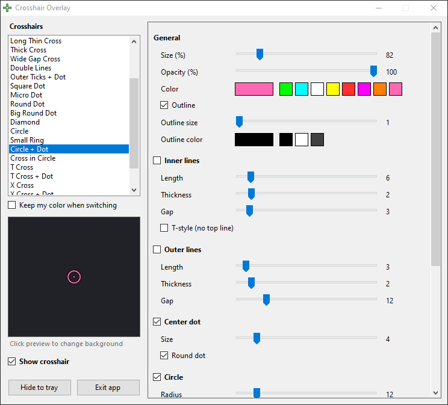
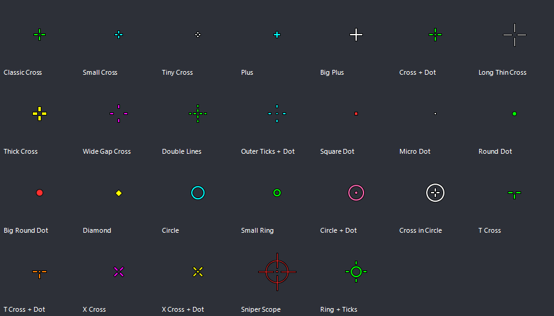

# Crosshair Overlay

A tiny Windows app that draws a custom crosshair in the exact centre of your screen, on top of every other window. Made for Valorant, works with any game that runs in windowed or borderless mode.





- 26 built-in crosshairs: crosses, dots, circles, T and X shapes, sniper scope and more
- Change size, color, opacity, outline, line length, thickness, gap, rotation and position
- Inner lines, outer lines, centre dot and circle can be mixed freely
- Click-through: the mouse never touches the overlay
- Hotkey (F8 by default) to show or hide it, also while in game
- Every change is saved instantly and restored the next time you start it
- One 34 KB exe, nothing to install

## Download

**[Download CrosshairOverlay.exe](https://github.com/einars-a/crosshair-overlay/raw/main/CrosshairOverlay.exe)**

Windows 10 or 11. Just run it. Windows SmartScreen may warn about an unknown publisher the first time: choose *More info* and then *Run anyway*.

## How to use

1. Start `CrosshairOverlay.exe`. The crosshair appears in the middle of the screen and the settings window opens.
2. Pick a crosshair from the list on the left and adjust it with the sliders on the right.
3. Close the settings window. The app keeps running in the system tray (bottom right).
   Double-click the tray icon to open settings again, right-click it to exit.
4. Press **F8** to show or hide the crosshair at any time. The key can be changed in settings.

### Game settings

The game must run in **Windowed Fullscreen** (borderless) display mode. In exclusive fullscreen Windows cannot draw anything over the game, so the crosshair will not be visible.

In Valorant: *Settings > Video > General > Display Mode > Windowed Fullscreen*.

## Is it allowed?

The app only draws a small picture on your screen. It does not read or change game memory, inject anything into the game or automate any input. Still, Riot does not officially approve third-party crosshair overlays, so use it at your own risk.

## Build it yourself

No tools needed, the C# compiler that ships with Windows is enough. Run `build.bat`, or:

```bat
%WINDIR%\Microsoft.NET\Framework64\v4.0.30319\csc.exe /nologo /target:winexe /optimize+ /out:CrosshairOverlay.exe /r:System.Windows.Forms.dll /r:System.Drawing.dll CrosshairOverlay.cs
```

Settings are stored in `%APPDATA%\CrosshairOverlay\settings.ini`. Delete that file to reset everything.

## License

MIT, see [LICENSE](LICENSE).
